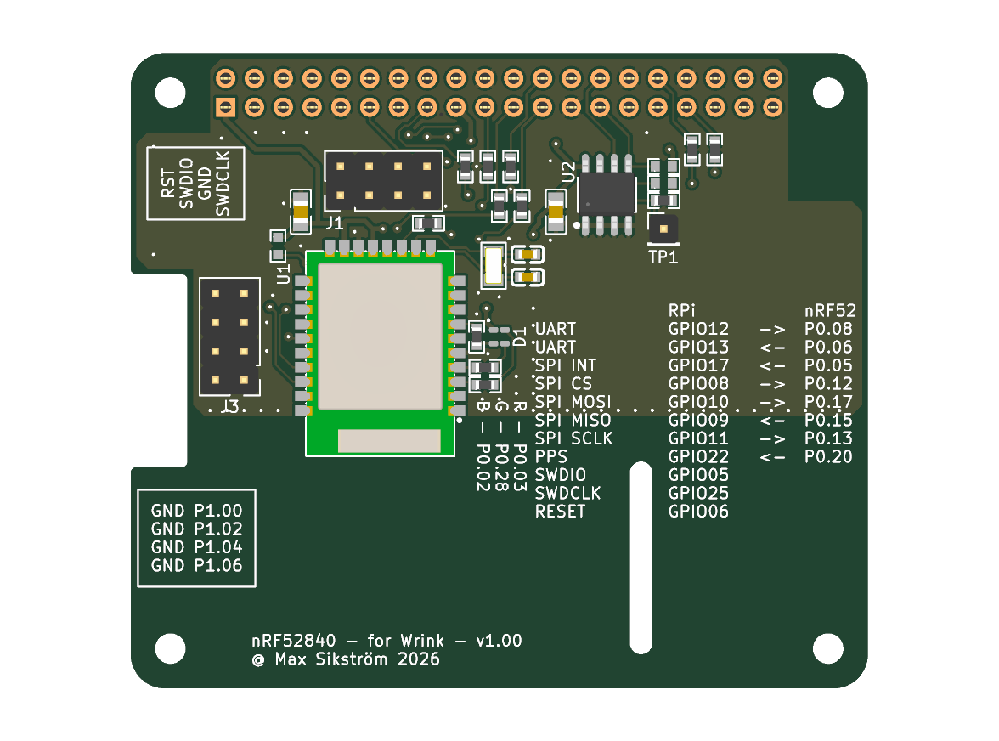
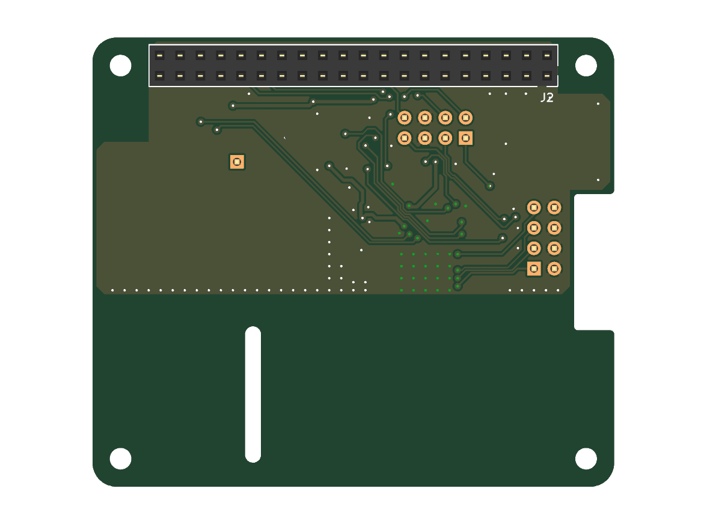
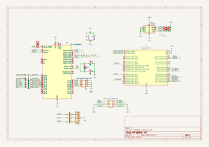

# rpi-nrf52840-hat

<!-- kifab:begin (generated by `kifab readme`; edits in here are lost) -->

## PCB

 

## Schematic

## Bill of materials

| Qty | Value | References | Footprint | Part |
| ---: | --- | --- | --- | --- |
| 2 | 4.7uF | C1, C5 | C0805 | [C20416422](https://www.lcsc.com/product-detail/C20416422.html), TCC0805X7R475K500FT |
| 2 | 18pF | C2, C3 | C0603 | [C1647](https://www.lcsc.com/product-detail/C1647.html), CL10C180JB8NNNC |
| 1 | RGB_CA | D1 | LED_RGB_1.6x1.5mm_CA_P4-1615 | [C7496855](https://www.lcsc.com/product-detail/C7496855.html), P4-1615G2B2R4TS2-06T-001-24 |
| 2 | Conn_02x04_Odd_Even | J1, J3 | PinHeader_2x04_P2.54mm_Vertical | [C41413841](https://www.lcsc.com/product-detail/C41413841.html), A254UP-ZS04P |
| 1 | Raspberry_Pi_4 | J2 | PinSocket_2x20_P2.54mm_Vertical | [C19725278](https://www.lcsc.com/product-detail/C19725278.html), HDGCPH2.54-PZS-2X20 |
| 11 | 330Ω | R1, R2, R3, R4, R5, R6, R7, R8, R12, R13, R15 | R0603 | [C23138](https://www.lcsc.com/product-detail/C23138.html), 0603WAF3300T5E |
| 1 | 4.7kΩ | R11 | R0603 | [C23162](https://www.lcsc.com/product-detail/C23162.html), 0603WAF4701T5E |
| 1 | E73-2G4M08S1C | U1 | WIRELM-SMD_E73-2G4M08S1C | [C356849](https://www.lcsc.com/product-detail/C356849.html) |
| 1 | 24C32 | U2 | SOP-8_L4.9-W3.9-P1.27-LS6.0-BL | [C18723546](https://www.lcsc.com/product-detail/C18723546.html), 24C32BN(XBLW) |
| 1 | 32.768kHz 12.5pF | X1 | CRYSTAL-SMD_L3.2-W1.5-1 | [C7462182](https://www.lcsc.com/product-detail/C7462182.html) |

<!-- kifab:end -->
